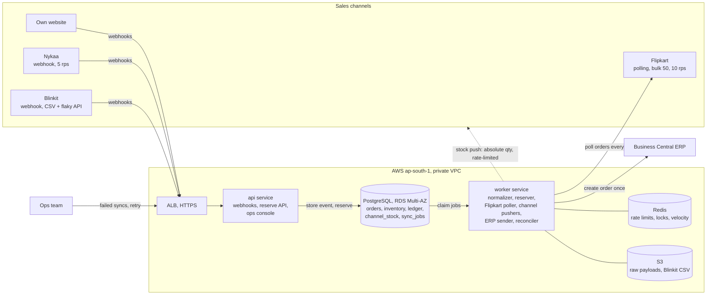

# Order & Inventory Sync Service: Design

**Summary.** I'm building v1 as a NestJS modular monolith on ECS Fargate, split into two services: `api` and `worker`.
**PostgreSQL is the only source of truth** for orders, stock and pending work. Stock is reserved with one conditional
`UPDATE` under a row lock. Every stock change writes a ledger row and marks the SKU "dirty" for each channel. Pushers
for each channel send **absolute quantities**, merged per SKU and ordered by urgency. ERP delivery uses a transactional
outbox plus an idempotency key. Redis only holds rate limits, locks and sales-velocity counters, so losing Redis never
loses an order.

## 1. Architecture



*Same diagram as an image: [architecture.png](architecture.png).*

- **`api`** (2 or more tasks, scales on CPU) handles webhooks: it verifies the signature, stores the raw event and
  replies `200` in under 50 ms. It also serves the synchronous `POST /reserve` used by our website's checkout, and the
  ops API and console.
- **`worker`** (2 or more tasks, scales on job backlog) runs the normalizers, the reserver, the Flipkart poller (a single
  instance, enforced by a Redis lock), one push loop per channel, the ERP sender and the nightly reconciler.
- Keeping ingestion separate from processing means webhooks are still accepted when workers or a channel are slow.

## 2. Data model

| Table | Key columns | Constraints / purpose |
|---|---|---|
| `inbound_events` | `channel, dedupe_key, event_type, event_time, payload jsonb, status, error` | **`UNIQUE(channel, dedupe_key)`** with `INSERT … ON CONFLICT DO NOTHING`, so duplicate deliveries stop here. `dedupe_key` is the channel's event ID, or a hash of (order ID, event type, time) when there isn't one. |
| `orders` | `id uuid, channel, external_order_id, status, last_event_time, payment_mode, pincode, total` | **`UNIQUE(channel, external_order_id)`**: one row per real order. Status only moves forward. |
| `order_items` | `order_id, sku, qty, unit_price` | `PK(order_id, sku)`, `qty > 0`. |
| `inventory` | `sku PK, on_hand, reserved` | **`CHECK (reserved >= 0 AND on_hand >= reserved)`**. Available stock is `on_hand − reserved`. |
| `inventory_ledger` | `sku, d_on_hand, d_reserved, on_hand_after, reserved_after, reason, ref_id, actor, at` | Append-only audit trail. **`UNIQUE(sku, reason, ref_id)`**, so the same order can never reserve or release twice. |
| `channel_stock` | `channel, sku, external_ref, desired_qty, desired_ver, pushed_qty, pushed_ver, priority, cap` | `PK(channel, sku)`. Records what each channel should show and what it was last told. A row is dirty when `desired_ver > pushed_ver`. |
| `sync_jobs` | `kind, ref_id, status, attempts, next_run_at, last_error, depends_on` | Outbox and job queue. **`UNIQUE(kind, ref_id)`** means one `ERP_CREATE` per order. The ops screen reads this table. |

`channel_push_log` (every value we sent to a channel, partitioned by month) and `channel_cursors` (the Flipkart polling
watermark) complete the schema.

## 3. Order ingestion

- **Webhooks** (website, Nykaa, Blinkit): store the event and acknowledge it. No business logic runs in the request, so
  a slow query never makes a channel time out and resend.
- **Website reserves before taking payment.** Our checkout calls `POST /reserve` before payment, so when stock runs out
  the shopper sees "out of stock" instead of getting a cancelled order. The reservation expires after 15 min unless the
  order-created webhook confirms it.
- **Flipkart polling:** one poller runs every 2 min and asks for orders changed since `cursor − 10 min`. The overlap
  covers late-arriving data, and the unique keys absorb the repeats. Polling uses 2 of Flipkart's 10 rps.
- **Duplicates** are dropped at `inbound_events`. Anything that gets through is harmless, because status only moves
  forward and ledger rows are unique.
- **Out-of-order events:** an event that would move an order backwards is logged and ignored. If `CANCELLED` arrives
  before `CREATED`, I create the order directly as `CANCELLED`, so the late `CREATED` can never reserve stock.
- **A channel that is down:** for webhooks I rely on the channel retrying, plus an hourly reconciliation pull of the last
  24 h of orders. For Flipkart, the cursor only moves forward after a successful poll. Each channel has its own worker
  pool and circuit breaker, so one bad channel cannot block the others.

## 4. Inventory consistency: two channels sell the last unit

Reservation is one transaction per order. It goes through the SKUs **in sorted order**, which prevents deadlocks:

```sql
UPDATE inventory SET reserved = reserved + $qty
WHERE sku = $sku AND on_hand - reserved >= $qty;
```

If any line updates 0 rows, the whole order rolls back and becomes `REJECTED_NO_STOCK` (v1 reserves all items or none).
On success, the **same transaction** writes the ledger rows, sets the order to `RESERVED`, bumps `desired_ver` on that
SKU's `channel_stock` rows and inserts the `ERP_CREATE` job.

**Walk-through.** `MRS-LIP-104` has `on_hand = 10` and `reserved = 9`. Nykaa order A and Blinkit order B each buy 1 in
the same second.

| t | Order A (Nykaa) | Order B (Blinkit) |
|---|---|---|
| 0 ms | Both webhooks are stored and acknowledged. Two workers pick them up. | |
| 5 ms | `UPDATE` sees `10 − 9 ≥ 1`, **takes the row lock** and sets `reserved = 10`. | Its `UPDATE` on the same row **waits** for the lock. |
| 8 ms | Writes the ledger row, marks A `RESERVED`, sets the SKU to show 0 with top priority, adds the ERP job. **Commits.** | |
| 8 ms | | The lock is released. Postgres **re-checks the `WHERE`** against the committed row: `10 − 10 ≥ 1` is false, so 0 rows change. |
| 9 ms | | B becomes `REJECTED_NO_STOCK`. A `CHANNEL_CANCEL` job and an ops alert are created. |
| < 2 s | Every channel is told 0: the website immediately, Nykaa on the next call, Flipkart in the next batch, Blinkit via its urgent API. | |

The order whose reservation commits first wins. The lock guarantees *we* never promise one unit twice. But **Blinkit had
already sold to a real customer**, and no lock on our side can undo that. So the real defence is how much stock we show:

`shown(channel, sku) = clamp(available − buffer(sku), 0, cap(channel, sku))`,
where `buffer(sku) = ceil(sales_per_min(sku) × 3 min × 1.2)`.

The 3 minutes cover Flipkart's 2-minute polling gap plus push time. When stock is low, the **slow channels go to 0 first**
(Flipkart, then Blinkit), and the last units stay on the website and Nykaa, where we see orders within seconds. Ops can
also set per-channel caps on hero SKUs before a sale. This is how I keep sale-day cancellations under 0.5%, which is
about 400 of 80,000 orders.

## 5. Stock push within 60 seconds

- Each push loop runs every 2 s. A Postgres `NOTIFY` wakes it immediately when a SKU hits zero.
- **Absolute quantity plus a version number**, never deltas. Retries and timeouts are safe, and an older push can never
  overwrite a newer one, because `pushed_ver` only moves forward (compare-and-set).
- **Merging and priority:** a burst of 40 sales becomes one call. Rows are sent in priority order: zero crossings, then
  low stock, then the rest by age. Pushes where the *shown* value doesn't change are skipped; for example, with
  `cap = 100` a drop from 480 to 470 costs no call.
- Rate limits use a Redis token bucket per channel, shared by all workers and set at 80% of the stated limit.

| Channel | Budget | Capacity | Sale peak (300 orders/min ≈ 150 distinct SKUs/min after merging) |
|---|---|---|---|
| Website | Direct | Unlimited | Instant |
| Nykaa | 4 rps × 1 SKU | 240 SKUs/min | Fits. Priority order keeps low-stock SKUs in seconds; a full sweep of all 1,200 SKUs would take 5 min. |
| Flipkart | 6 rps × 50 SKUs (2 rps kept for polling) | 18,000 SKUs/min | One bulk call every 2 s; on `429`, back off per `Retry-After`. |
| Blinkit | REST, 4 concurrent, 3 s timeout | Assumed enough | The daily full CSV at 04:00 corrects any drift. |

## 6. Failure handling

- **Retries:** every external call is a `sync_jobs` row (or a dirty `channel_stock` row), retried with exponential backoff
  and jitter from 5 s to 30 min. After N attempts it becomes `DEAD`. The **ops screen** lists dead jobs with the payload
  and last error, and its **Retry** button resets `status` and `attempts`.
- **ERP exactly once:** the job is created inside the reservation transaction (`UNIQUE(kind, order_id)`) and claimed with
  `FOR UPDATE SKIP LOCKED`. The order is posted with `externalDocumentNumber = orders.id`. Before every retry, the sender
  asks Business Central for that number and marks the job done if the order already exists. Delivery is at least once;
  this check makes the effect exactly once. `ERP_CANCEL` waits for its `ERP_CREATE` (`depends_on`).
- **ERP Sunday downtime:** a circuit breaker opens after 5 failures and probes every 2 min. Jobs wait in Postgres: about
  700 orders on a normal Sunday, 36,000 in a sale-day worst case. When BC is back they drain oldest first at a capped
  rate.
- **Blinkit timeouts (2%):** a timeout is ambiguous, because the update may have applied. Values are absolute, so I just
  retry, 3 times within 10 s. All three failing has a probability of about 0.0008%. The next cycle or the daily CSV
  catches the rest.
- **Messages that keep failing** go to `DEAD` and raise an alert. Jobs are claimed one row at a time, so they never block
  other work.
- **Reconciliation** (nightly, hourly on sale days): compare `on_hand` with Business Central's stock and write any
  difference as a `RECONCILE` ledger row.

## 7. Observability (day one)

1. **Sync lag:** age of the oldest dirty `channel_stock` row, per channel. Alert if over 60 s for 5 min.
2. **Oversell rate:** `REJECTED_NO_STOCK` divided by orders over 15 min. Alert above 0.3%, an early warning before 0.5%.
3. **ERP backlog:** age of the oldest pending ERP job. Alert at 30 min, or at 3 h during the Sunday window.
4. **Ingestion heartbeat:** no Flipkart poll for 6 min, or no events from a channel for 30 min in business hours.
5. **Dead jobs:** any count above 0 pages ops.

## 8. Scope: what I'm leaving out of v1

- **Kafka, SQS and microservices:** 5 orders/sec doesn't need them, and 3 developers have 6 weeks.
- **Partial fulfilment:** v1 reserves all items or none, which is simpler and safer.
- **Forecast-based channel allocation:** static caps plus a velocity buffer meet the target; I'd tune it with real data.
- **Catalogue and price sync, and a returns QC workflow:** returns go back on sale only once the warehouse marks them
  sellable.
- **Multiple warehouses and a rich dashboard:** the ops UI is just failed syncs, a per-SKU ledger view and channel caps.

**Cost (estimate):** Fargate with 4 small tasks ≈ ₹6k, RDS `db.t4g.medium` Multi-AZ ≈ ₹12k, ElastiCache `t4g.small`
≈ ₹3k, ALB ≈ ₹2k, NAT, CloudWatch and S3 ≈ ₹6k. **About ₹29k/month**, leaving headroom within ₹50k.

## 9. Trade-offs

| Decision | Chose | Rejected | Why |
|---|---|---|---|
| Where to reserve stock | Postgres conditional `UPDATE` | Redis Lua counters | Redis would mean two sources of truth and can lose writes on failover. 5 tx/s is easy for Postgres, and the ledger row goes in the same transaction. |
| Queue | Postgres `sync_jobs` outbox | BullMQ, SQS, Kafka | The job commits with the business change, so it can never be lost. No new component, and the ops screen is a SQL query. |
| Stock push payload | Absolute quantity + version | Per-order deltas | Safe to retry, which handles Blinkit timeouts; merging lets Nykaa's 5 rps keep up. |
| Overselling defence | Buffer + slow channels go to 0 first | Exact counts everywhere | Flipkart's polling gap makes exact counts unreachable. A few lost sales are cheaper than seller-rating damage. |
| Deployment | Modular monolith | A service per channel | Isolation comes from a worker pool and circuit breaker per channel; one deploy suits a small team. |

## 10. Stretch A: a second warehouse in Bengaluru

`inventory` and the ledger gain a `warehouse_id`. Reservation picks a warehouse by pincode zone (nearest one with stock,
otherwise the other) and still runs one conditional `UPDATE`. National marketplaces are shown the total across
warehouses minus the buffer. Blinkit is hyperlocal, so it gets stock per warehouse. ERP orders carry a location code.
The concurrency model stays the same.

## 11. Assumptions

- Webhooks are signed and are retried on non-2xx responses for a few hours. Each channel has an order-list API we can use
  for reconciliation.
- Channel stock APIs accept an absolute quantity. The SKU-to-channel ID mapping lives in `channel_stock.external_ref`.
- Blinkit's REST API may be used for every change. If it is limited to urgent changes, only zero crossings and low-stock
  changes use it, and the CSV covers the rest.
- Business Central accepts `externalDocumentNumber` on sales orders and allows filtering by it. It is the master for goods
  receipts and adjustments, which we pull every 15 min.
- `on_hand` decreases at dispatch. Cancellations before dispatch release stock immediately. Returns are restocked after QC.
- A "confirmed order" is one that reserved stock successfully, whether prepaid or cash on delivery.
- Times are stored in UTC. `event_time` is used to order events for one order, not to decide who wins stock.
- Prices are taken from the channel as sent and are not checked.

**AI usage:** I used Claude for help in this document.
